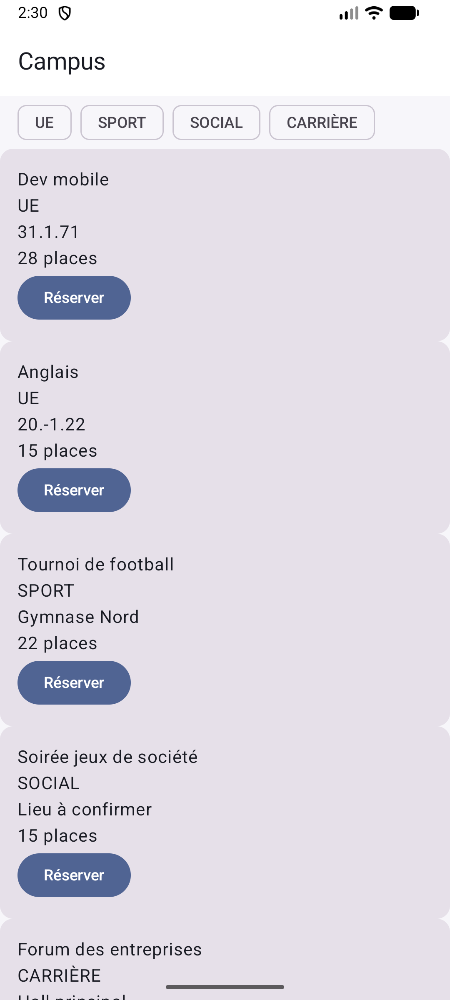
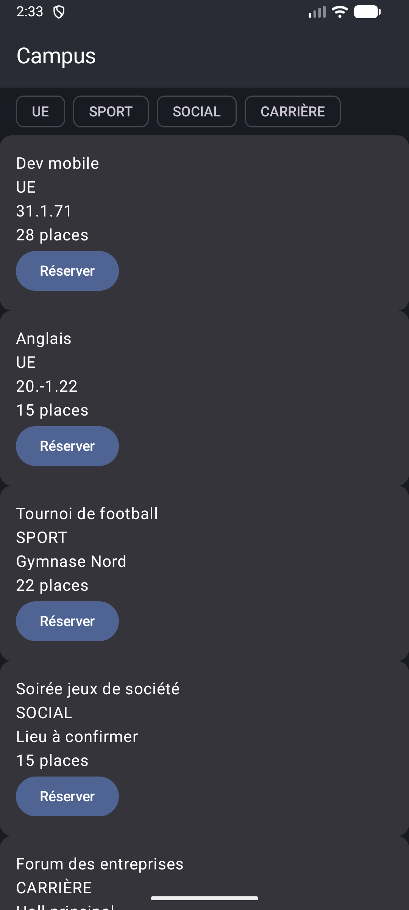
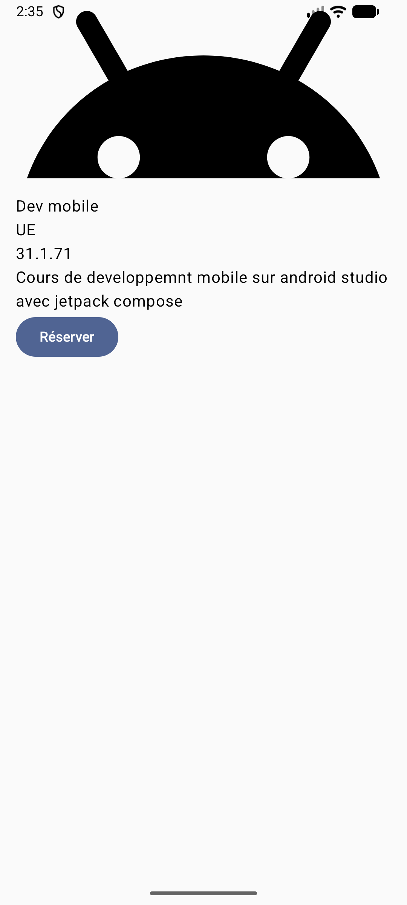

### Campus v0.2 Application Android

#### Objectif

Projet réalisé dans le cadre de ma formation au CNAM, UE développement mobile encadré par M. Bellano Frédéric.

L'objectif est de comprendre les différents étapes de réalisation d'une app Android en Kotlin et Jetpack Compose 
(Interface utilisateur, création de composant réutilisable comme les cartes d'évènements).

#### Captures d'écran

- Liste des évènements (mode clair)

- Liste des évènements (mode sombre)

- Détail d'un évènement

- Scrolle fonctionne

